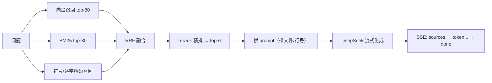

# RepoTalk


把 GitHub 仓库喂进来，用自然语言提问，得到**带文件和行号引用**的流式答案。

**在线体验**：<http://47.112.199.52/>（访客可直接提问，有每日配额；管理员登录后免配额。域名备案未通过，暂用 IP + HTTP）

## 实测效果（`requests` 仓库，30 题）

检索消融（同一数据集、同一 k=6、零 LLM 成本，可复现）：

| 检索模式 | Recall@6 | MRR@6 | nDCG@6 | 单题耗时 |
|---|---|---|---|---|
| 纯向量 | 0.033 | 0.017 | 0.021 | 0.21s |
| 混合召回 + RRF | 0.950 | 0.967 | 0.942 | 1.22s |
| 混合召回 + rerank | **0.983** | **0.983** | **0.967** | 2.20s |

端到端 RAGAS（30 题，历史基线 vs 调优后）：

| 指标 | 调优前 | 调优后 |
|---|---|---|
| context_recall | 18.9% | **92.2%** |
| context_precision | 27.2% | **76.9%** |
| faithfulness | 28.8% | **93.3%** |
| answer_relevancy | 74.4% | 72.5% |

**结论：这个系统的瓶颈在检索，不在生成。** 纯向量在代码定位上几乎不可用（3.3%），多路召回把召回拉到 95%，rerank 只补最后 3 个点、但要多付约 1 秒/题。完整实验口径与局限见 [docs/EVALUATION.md](docs/EVALUATION.md)。

## 怎么做出来的

1. **按语法树切分，不按字数切**：tree-sitter 以函数/类为边界切块，保留 `file_path` / `start_line` / `symbol`，检索出来的是完整可用的代码，而不是半截函数。
2. **多路召回 + RRF 融合**：向量（bge-m3）+ BM25 + 符号精确匹配 + 逐字原文召回，自写 RRF 只按排名融合、规避量纲不一致，再用 bge-reranker 精排。
3. **成本与边界可控**：访客每日配额、演示模式限 4 块上下文 / 320 输出 token、BYOK 域名白名单、rerank 失败自动降级为 RRF 顺序；定位类问题（"X 在哪定义"）先校验检索块里有没有真正的 `def X` / `class X`，没有就直接回答"当前仓库中没有找到 X 的定义"，不让 LLM 拿无关代码编解释。
4. **多轮上下文**：前端只带最近 3 轮问答，后端按 `history_max_messages` / `history_max_chars` 硬约束裁剪后注入 prompt；追问（"它""那 X 呢"）默认开启查询改写（`ENABLE_QUERY_REWRITE`），规则前置判断——含指代词/序数回指/追问前缀才触发，首轮与独立问题零成本；改写提示词强制把指代替换为历史中的具体名称、序数回指只补全所属文件，残留指代自动重改一次，超时或失败回退原问题。已拒答的不存在符号由 `sticky_refusal` 兜底，换句式追问也不会编造。10 组指代型追问实测：不改写 Recall@6 40%、MRR 0.183，改写后 **100% / 0.858**（人工改写上限 1.000）；单轮问题 0/30 触发，历史注入仅增加 7–10 个 prompt token；线上 29 轮追问回归全部通过。详见 [docs/EVALUATION.md](docs/EVALUATION.md)。



录入是异步链路：`POST /repos` → Redis 队列 → arq worker（浅克隆 → AST 切分 → 向量化入 pgvector → BM25 原料入 Redis）→ 前端订阅进度。

## 技术栈

| 层 | 选型 |
|---|---|
| 后端 | Python 3.12 / FastAPI / arq（Redis 队列）/ LangChain LCEL |
| 检索 | PostgreSQL 16 + pgvector、bge-m3、bge-reranker-v2-m3、jieba |
| 生成 | DeepSeek `deepseek-chat`（temperature=0） |
| 前端 | Vite + React + TypeScript |
| 部署 | Docker Compose 五容器（db / redis / backend / worker / nginx），Nginx 承载 SSE 直通 |

## 快速开始

```bash
git clone <repo-url> && cd repotalk
# backend/.env 填入 LLM / Embedding Key（模板见 docs/ARCHITECTURE.md）
docker compose up -d --build
# 打开 http://localhost，接口文档 http://localhost:8000/docs
```

本地开发（后端 + worker + 前端热更新）与逐条排障，见 [docs/ARCHITECTURE.md](docs/ARCHITECTURE.md)。

## 目录结构

```
repotalk/
├── backend/app/
│   ├── api/        # 路由：repos / chat / auth / demo
│   ├── core/       # 配置、DB、缓存、配额、安全
│   ├── rag/        # AST 切分、混合检索、prompt 与生成
│   ├── workers/    # arq 异步解析
│   └── main.py
├── backend/tests/  # 评测脚本、指标库、数据集
├── frontend/src/   # 工作台
├── docs/           # 架构、评测、决策记录
├── nginx/
└── docker-compose.yml
```

## 文档

- [docs/EVALUATION.md](docs/EVALUATION.md)：检索消融的方法、结果、口径与局限
- [docs/DECISIONS.md](docs/DECISIONS.md)：三个关键技术决策的背景、备选、代价与验证
- [docs/ARCHITECTURE.md](docs/ARCHITECTURE.md)：完整架构、接口、部署、踩坑记录

## 已知限制

- 管理员为单账号密码模式，无多用户 / RBAC
- 当前单实例部署（BM25 索引在进程内存，`--workers 1`）
- 公网为 HTTP + IP（域名备案未通过），BYOK 功能因此默认关闭
- 单元测试与 CI 已接入（78 个纯单测用例 / 12 个测试文件：ruff + pytest + 前端构建）；检索评测以脚本形式可复现
